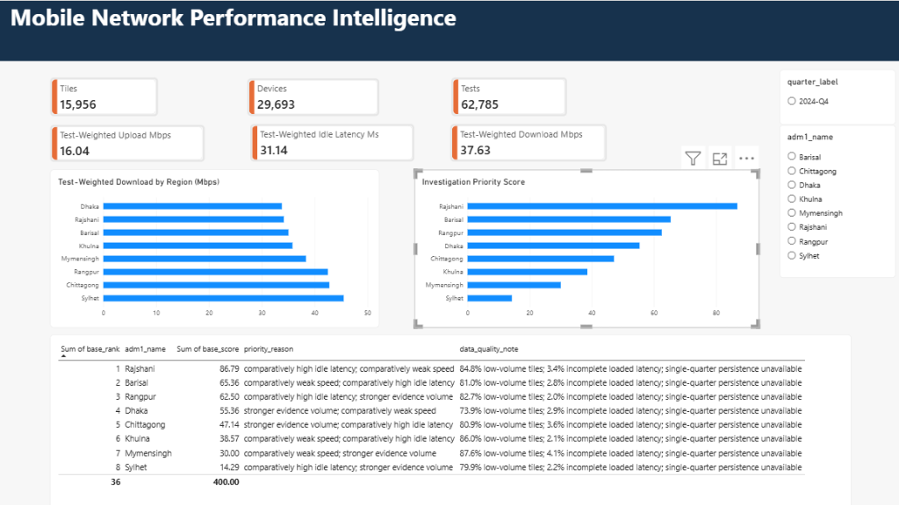
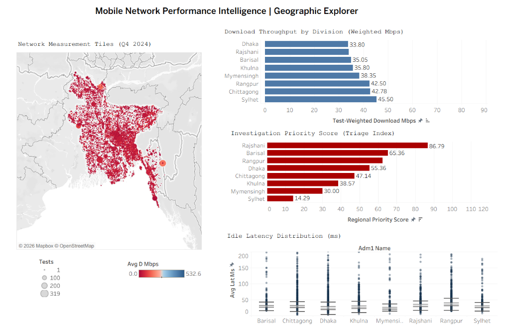

# Mobile Network Performance Intelligence

A phased, reproducible portfolio project that investigates public Ookla mobile-network performance map tiles for Bangladesh. The project treats the data as quarterly, aggregated measurements - not cell towers, subscribers, operator results, outages, or live monitoring.

## Current status

All 10 project phases, complete interview preparation, presentation scripts, and native Desktop BI builds are complete. The interactive **Power BI Management Dashboard** (`powerBI/dashboard.pbix`) and **Tableau Geographic Explorer** (`tableau/dashboard.twb`) are fully built, reconciled against benchmarks, verified through the Phase 9 assurance suite, and documented with native desktop screenshots.

## Interactive BI dashboards

The project provides interactive implementations in both **Power BI** and **Tableau** sharing the exact same governed metric definitions and SQLite/Python benchmark reconciliation:

### Power BI: Governed Executive Management Overview
- **Workbook:** `powerBI/dashboard.pbix`
- **Architecture:** Clean Star Schema (`DimRegion`, `DimQuarter`, `FactTilePerformance`, `FactRegionPriority`) with 1-to-many single-direction relationships.
- **Components:** 6 KPI metric cards, regional download throughput bar chart, triage priority score bar chart, and regional priority ranking table.



### Tableau: Geographic Explorer & Distribution Inspection
- **Workbook:** `tableau/dashboard.twb`
- **Dashboard:** Geographic Explorer
- **Architecture:** Flat tile-quarter extract (15,956 tiles) designed for map-led exploration and distribution inspection.
- **Components:** Full Bangladesh measurement tile map (with test-volume sizing and speed gradient), regional download throughput, triage priority index, and division-level idle latency box-and-whisker distribution.



## Verified headline results

- 15,956 Q4 2024 Bangladesh tile records across eight ADM1 regions.
- 62,785 contributing tests; these are not subscribers or population.
- Test-weighted download 37.625394 Mbps, upload 16.039675 Mbps, and idle latency 31.137915 ms.
- 80.20% of tiles have only 1-4 tests, requiring an evidence-volume warning.
- Rajshani is the stable first investigation priority across four tested weighting scenarios, not a proven network fault.
- Python/SQLite, Power BI-import, and Tableau-export reconciliation checks pass within `1e-9` tolerance.

## Phase 1 outputs

- `docs/BUSINESS_REQUIREMENTS.md` - stakeholders, decisions, scope, and answerable questions.
- `reports/SOURCE_MANIFEST.md` - source identity, access evidence, licensing, and provenance.
- `docs/DATA_DICTIONARY.md` - source fields, units, meanings, and cautions.
- `reports/DATA_QUALITY_BASELINE.md` - observed schema, counts, nulls, coordinate coverage, and representative records.
- `notebooks/01_source_review.ipynb` - reproducible source-inspection walkthrough.
- `src/inspect_source.py` - repeatable inspection and Bangladesh bounding-box coverage check.
- `docs/PROJECT_DECISIONS.md` and `docs/LEARNING_NOTES.md` - decision log and learning checkpoint.

## Setup on Windows PowerShell

```powershell
uv venv --python 3.11 .venv
.\.venv\Scripts\Activate.ps1
python -m pip install -r requirements.txt
```

If `uv` is unavailable, use an installed Python 3.11+ executable with `-m venv .venv`.

Download the official Q4 2024 mobile Parquet file to:

```text
data/raw/2024-10-01_performance_mobile_tiles.parquet
```

Then run:

```powershell
python -m src.inspect_source
jupyter lab notebooks/01_source_review.ipynb
```

The inspection command writes machine-readable evidence under `reports/generated/`. Raw and generated data are excluded from Git.

Run the Phase 2 extraction with:

```powershell
python -m src.extract
jupyter lab notebooks/02_geographic_extraction.ipynb
```

This creates the ignored analytical subset at `data/interim/bgd_mobile_tiles_2024_q4.parquet`, a committed audit JSON, and a geographic validation figure. PyArrow and GeoPandas handle Parquet/spatial work; SQLite is the selected database for later phases.

Run Phase 3 with:

```powershell
python -m src.clean
python -m src.validate
jupyter lab notebooks/03_data_cleaning.ipynb
```

The processed Parquet and CSV are written under `data/processed/` and excluded from Git. Their hashes, validation results, and all exclusion counts are committed under `reports/`.

Run Phase 4 with:

```powershell
python -m src.build_database
python -m src.run_sql
python -m src.reconcile
jupyter lab notebooks/04_sql_analytics.ipynb
```

The generated SQLite database remains under `data/processed/`. Named SQL results, build evidence, and Python reconciliation evidence are written under `reports/generated/`.

Run Phase 5 with:

```powershell
python -m src.eda
jupyter lab notebooks/05_eda.ipynb
```

The EDA command generates eight analytical figures, descriptive statistics, regional comparisons, association measures, and a machine-readable summary.

Run Phase 6 with:

```powershell
python -m src.score
jupyter lab notebooks/06_scoring.ipynb
```

The scoring command creates an ADM1 priority dataset, an auditable score trace, a base-ranking figure, and a sensitivity figure. It uses the processed analytical data produced alongside the SQLite workflow and does not introduce another database engine.

Prepare the Phase 7 Power BI handoff with:

```powershell
python -m src.export_power_bi
```

This regenerates four curated Import-mode CSVs from SQLite/Phase 6 output, reconciles the default view plus Dhaka and Rajshani filters, and writes the dashboard build reference. See `dashboards/power_bi/MODEL_AND_BUILD_GUIDE.md` for the model, visuals, interactions, refresh steps, and explicit DAX measures. The verified workbook is saved at `powerBI/dashboard.pbix`.

Prepare the Phase 8 Tableau handoff with:

```powershell
python -m src.export_tableau
```

This creates a flat tile-quarter explorer export, complete field dictionary, real selected-tile trace, Tableau/SQLite reconciliation, and a map-led build reference. See `dashboards/tableau/TABLEAU_BUILD_GUIDE.md` for worksheets, calculated fields, filters, actions, tooltips, packaging, and Tableau Public cautions. The verified workbook is saved at `tableau/dashboard.twb`.

Run the Phase 9 assurance gate with:

```powershell
python -m src.assure
python -m unittest discover -s tests -v
```

The assurance command verifies required portfolio artifacts, published headline claims, automated cross-tool reconciliation layers, and native Desktop BI workbooks.

Generate and review the final real-evidence traces with:

```powershell
python -m src.final_trace
```

<!-- Final teaching artifacts:

- `docs/WORKFLOW_EXPLANATION.md` - architecture and mandatory sections 10A-10J.
- `docs/EXAMPLE_TILE_TRACE.md` - actual quadkey through every implemented layer.
- `docs/KPI_RECONCILIATION.md` - Dhaka weighted-download proof across four environments.
- `docs/RUNBOOK.md` - clean Windows reproduction and troubleshooting.
- `docs/INTERVIEW_QA.md` - all phase answers, 50-question drill, and debugging exercises.
- `docs/PROJECT_PRESENTATION.md` - 60-second, 3-minute, 5-minute, management, CV, and portfolio versions. -->

## Source and license

Speedtest by Ookla Global Fixed and Mobile Network Performance Maps are licensed under CC BY-NC-SA 4.0. geoBoundaries ADM1 data is separately licensed under CC0 1.0. See `reports/SOURCE_MANIFEST.md` for URLs, access dates, and attribution requirements.

## Scope guardrail

Do not infer operator performance, coverage, outages, root causes, or population experience from this dataset alone. All published findings must be reproducible from verified project artifacts and must carry appropriate sampling and aggregation caveats.
